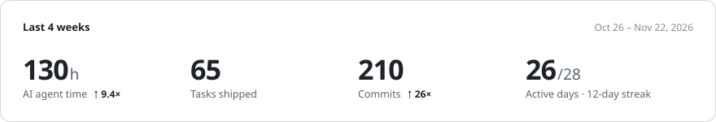
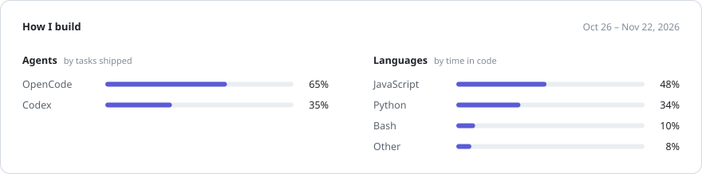
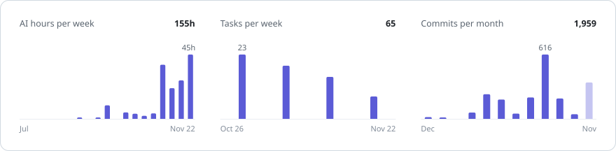
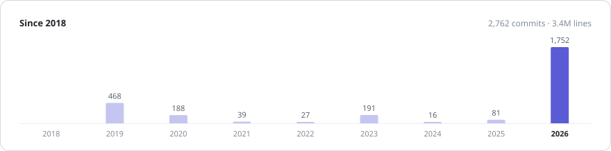

# So

AI engineer and founder of Qolso. I build, launch, and measure AI products at founder speed.

[Portfolio](https://sonozaki7.github.io/portfolio) · [X](https://x.com/ghtght_7)

<picture>
  <source media="(max-width: 767px)" srcset="./assets/pulse-mobile.svg">
  
</picture>

<picture>
  <source media="(max-width: 767px)" srcset="./assets/stack-mobile.svg">
  
</picture>

<picture>
  <source media="(max-width: 767px)" srcset="./assets/trends-mobile.svg">
  
</picture>

<picture>
  <source media="(max-width: 767px)" srcset="./assets/history-mobile.svg">
  
</picture>

## Monthly SaaS earnings

Only includes SaaS.

- 2024
  - Nov: 0 MRR
  - Dec: 0 MRR

- 2025
  - Jan: 0 MRR
  - Feb: 0 MRR
  - Mar: 0 MRR
  - Apr: 0 MRR
  - May: 0 MRR
  - Jun: 0 MRR
  - Jul: 170 MRR
  - Aug: 0 MRR
  - Sep: 0 MRR
  - Oct: 0 MRR
  - Nov: 0 MRR
  - Dec: 0 MRR

- 2026
  - Jan: 0 MRR
  - Feb: 0 MRR
  - Mar: 0 MRR
  - Apr: 0 MRR
  - May: 0 MRR
  - Jun: 0 MRR
  - Jul: 0 MRR
  - Aug: 0 MRR
  - Sep: 0 MRR
  - Oct: 0 MRR
  - Nov: 0 MRR
  - Dec:

- 2027
  - Jan:
  - Feb:
  - Mar:
  - Apr:
  - May:
  - Jun:
  - Jul:
  - Aug:
  - Sep:
  - Oct:
  - Nov:
  - Dec:

- 2028
  - Jan:
  - Feb:
  - Mar:
  - Apr:
  - May:
  - Jun:
  - Jul:
  - Aug:
  - Sep:
  - Oct:
  - Nov:
  - Dec:

How this works

A scheduled job adds up AI agent time, shipped tasks and commits across all of my work, private projects included, and redraws these cards once a week. Only weekly totals are published: no project names, no day-by-day detail, no timestamps.

