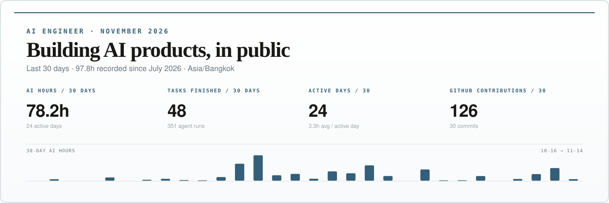
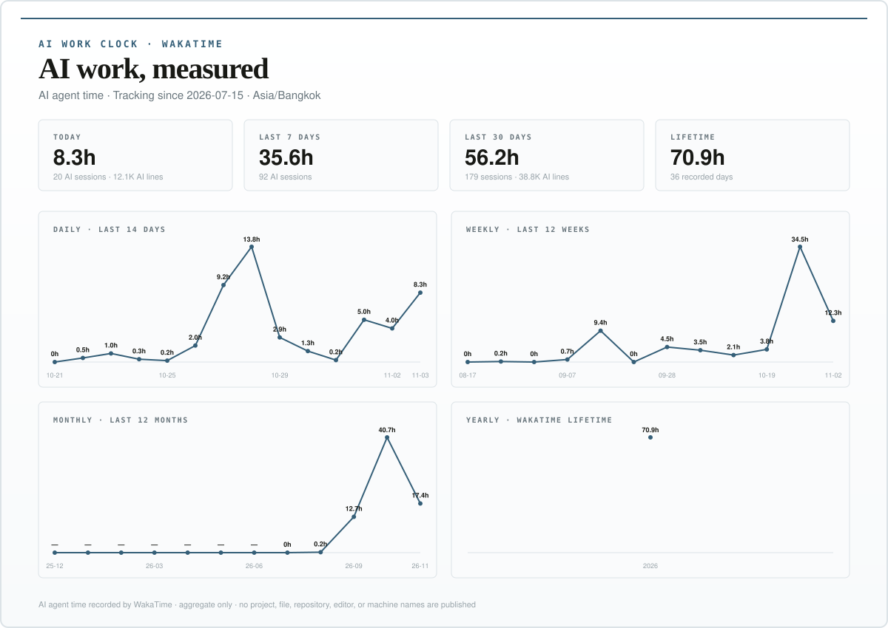
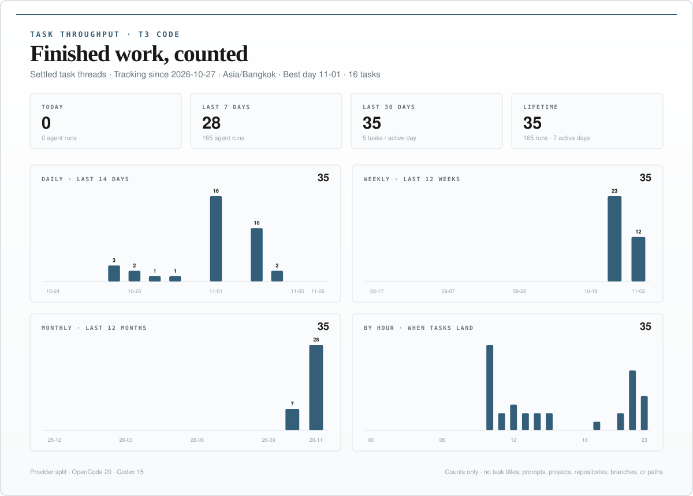
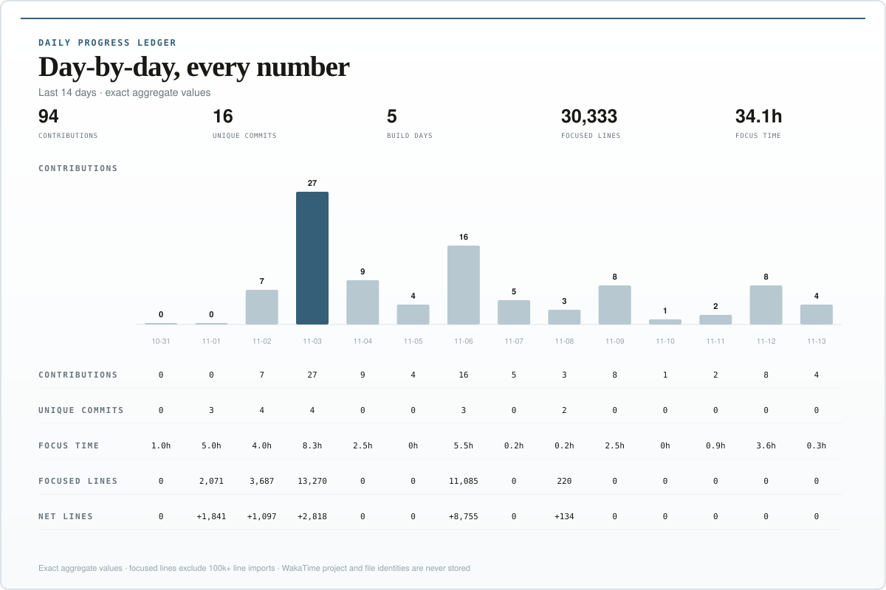
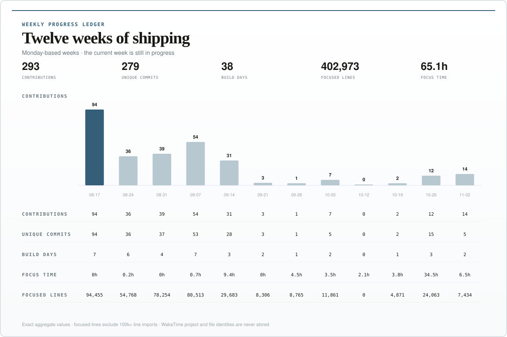
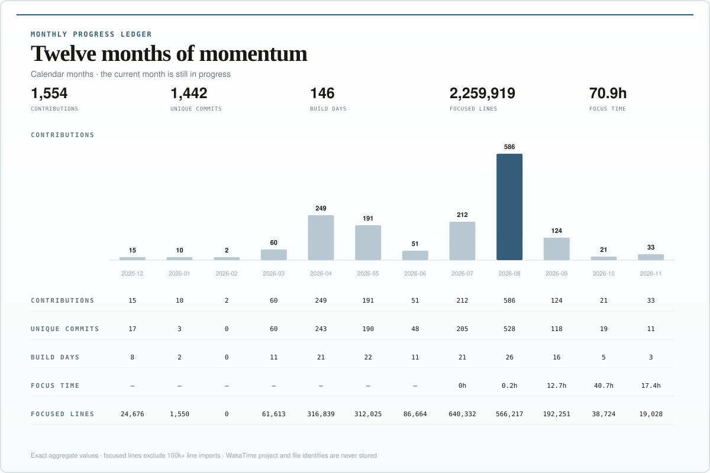
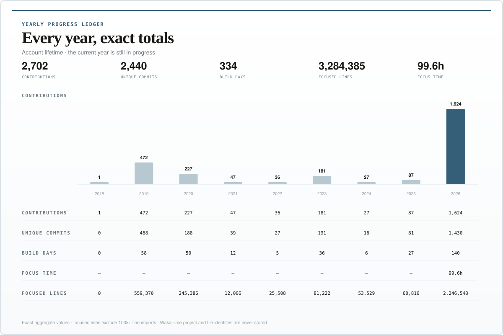
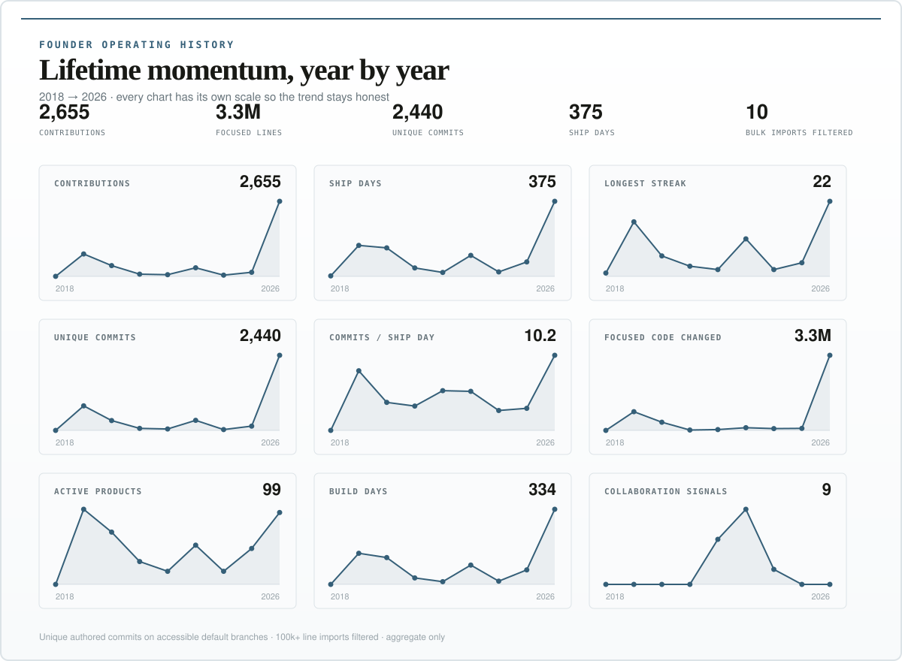
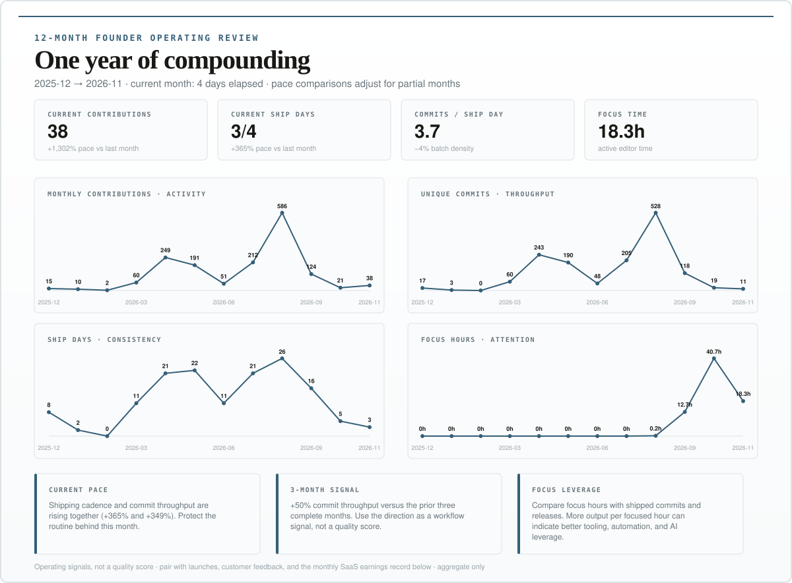

# So — AI engineer

I build, launch, and measure AI products at founder speed.

<a href="https://github.com/sonozaki7/sonozaki7/blob/main/metrics/overview.json">
  <picture>
    <source media="(max-width: 800px)" srcset="./assets/overview-mobile.svg" />
    
  </picture>
</a>

Last 30 days · Asia/Bangkok · refreshed automatically

## AI work clock

<picture>
  <source media="(max-width: 800px)" srcset="./assets/founder-focus-mobile.svg" />
  
</picture>

Hours measured by WakaTime across Codex, T3 Code, and OpenCode · aggregate only

## Finished tasks

<picture>
  <source media="(max-width: 800px)" srcset="./assets/founder-tasks-mobile.svg" />
  
</picture>

Tasks settled in T3 Code · counts only, never titles or project names

Daily, weekly, monthly, and yearly detail

### Daily · last 14 days

<picture>
  <source media="(max-width: 800px)" srcset="./assets/founder-daily-mobile.svg" />
  
</picture>

### Weekly · last 12 weeks

<picture>
  <source media="(max-width: 800px)" srcset="./assets/founder-weekly-mobile.svg" />
  
</picture>

### Monthly · last 12 months

<picture>
  <source media="(max-width: 800px)" srcset="./assets/founder-monthly-mobile.svg" />
  
</picture>

### Yearly · account lifetime

<picture>
  <source media="(max-width: 800px)" srcset="./assets/founder-yearly-mobile.svg" />
  
</picture>

Lifetime trend

<picture>
  <source media="(max-width: 800px)" srcset="./assets/founder-lifetime-mobile.svg" />
  
</picture>

Year-by-year from account creation · giant 100k+ line imports are filtered so ordinary work stays visible.

Twelve-month operating review

<picture>
  <source media="(max-width: 800px)" srcset="./assets/founder-progress-mobile.svg" />
  
</picture>

Month-by-month comparison · partial months are pace-adjusted.

## Monthly SaaS earnings

Only includes SaaS.

- 2024
  - Nov: 0 MRR
  - Dec: 0 MRR

- 2025
  - Jan: 0 MRR
  - Feb: 0 MRR
  - Mar: 0 MRR
  - Apr: 0 MRR
  - May: 0 MRR
  - Jun: 0 MRR
  - Jul: 170 MRR
  - Aug: 0 MRR
  - Sep: 0 MRR
  - Oct: 0 MRR
  - Nov: 0 MRR
  - Dec: 0 MRR

- 2026
  - Jan: 0 MRR
  - Feb:
  - Mar:
  - Apr:
  - May:
  - Jun:
  - Jul:
  - Aug:
  - Sep:
  - Oct:
  - Nov:
  - Dec:

- 2027
  - Jan:
  - Feb:
  - Mar:
  - Apr:
  - May:
  - Jun:
  - Jul:
  - Aug:
  - Sep:
  - Oct:
  - Nov:
  - Dec:

- 2028
  - Jan:
  - Feb:
  - Mar:
  - Apr:
  - May:
  - Jun:
  - Jul:
  - Aug:
  - Sep:
  - Oct:
  - Nov:
  - Dec:

How this tracker works

The tracker runs from this repository with a daily GitHub Action. It reads GitHub contribution totals and commit diff statistics, plus aggregate AI agent time from WakaTime, and produces the graphics above plus machine-readable [`overview.json`](./metrics/overview.json), [`latest.json`](./metrics/latest.json), [`cadence.json`](./metrics/cadence.json), [`history.json`](./metrics/history.json), [`focus.json`](./metrics/focus.json), and [`t3-summary.json`](./metrics/t3-summary.json). Private activity is included only in aggregate.

WakaTime is read through a private, read-only OAuth app rather than a personal API key, because WakaTime restricts personal keys to plugin endpoints. Only aggregate hours and AI session counts are stored.

Finished-task counts come from T3 Code's own settled-thread history, which lives only on the machine that runs it. A small local collector reads that database every 30 minutes and publishes only per-day counts.

Repository names, project names, task titles, prompts, file paths, branch names, commit messages, source code, editor or machine identities, and secrets are never written into the generated files.

Metrics include authored commits on the default branch of accessible, non-archived repositories. Lines changed are a momentum signal, not a quality score. Shipping useful product remains the goal.

Share the momentum

A social-ready [`founder-progress.png`](./assets/founder-progress.png) and [`share-copy.txt`](./assets/share-copy.txt) refresh with the daily build. Download both whenever you want to post the latest streak.

